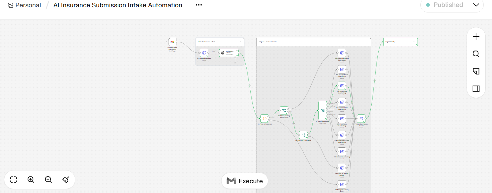
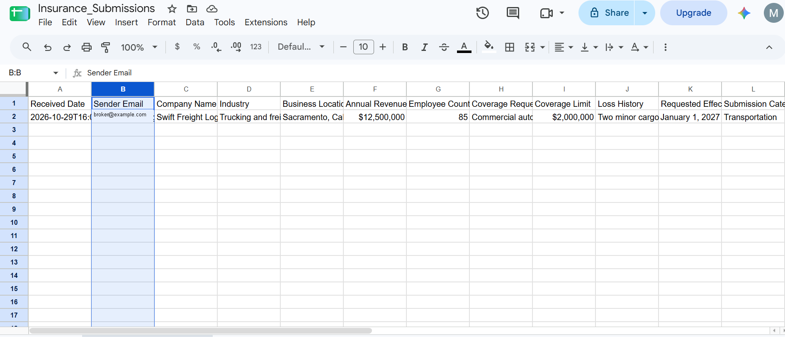

# AI Insurance Submission Intake Automation

An AI-enabled commercial-insurance intake workflow that reads broker emails, extracts structured submission data, validates required information, applies confidence-based routing, logs every case, and escalates uncertain or failed cases to people.

> **Hiring-manager summary:** This project demonstrates end-to-end product thinking for an AI/automation workflow: problem framing, requirements, business rules, workflow design, deterministic validation, human-in-the-loop controls, UAT, and a measurable rollout plan. It is a working portfolio prototype—not a production underwriting system.

## Demo

### End-to-end n8n workflow

### Structured Google Sheets output

The visible sender value has been replaced with synthetic data for privacy.

## The problem

Commercial-insurance submissions often arrive as unstructured emails. Intake teams manually read each message, re-key business and coverage details, chase missing information, choose an underwriting queue, and track exceptions. This creates avoidable handling time, inconsistent routing, rework, and limited visibility into the intake funnel.

## The solution

This n8n workflow automates first-pass intake while keeping underwriting decisions with professionals:

1. **Capture** an unread Gmail message with the configured submission subject.
2. **Normalize** sender, subject, body, received time, and Gmail message ID.
3. **Extract** insurance fields with OpenAI using a strict JSON contract.
4. **Validate** five required fields deterministically in an n8n Code node.
5. **Triage** missing, low-confidence, successful, and failed cases.
6. **Route** complete high-confidence submissions by business category.
7. **Log** a normalized 20-column record in Google Sheets.
8. **Notify** underwriting and request missing information from the broker when needed.

The AI extracts, classifies, and recommends. It does **not** approve, decline, price, bind, or quote coverage.

## Workflow and architecture

~~~mermaid
flowchart LR
    A[Gmail trigger] --> B[Normalize email]
    B --> C[OpenAI structured extraction]
    C --> D[Parse and validate JSON]
    D --> E{Processing error?}
    E -- Yes --> F[Manual Intake Review]
    E -- No --> G{Required fields missing?}
    G -- Yes --> H[Intake Review Team]
    H --> I[Broker follow-up]
    G -- No --> J{Confidence below 80?}
    J -- Yes --> K[Senior Intake Review]
    J -- No --> L{Submission category}
    L --> M[Transportation]
    L --> N[Commercial]
    L --> O[Construction]
    L --> P[Healthcare]
    L --> Q[Professional Lines]
    L --> R[General Underwriting]
    F --> S[Finalize record]
    H --> S
    K --> S
    M --> S
    N --> S
    O --> S
    P --> S
    Q --> S
    R --> S
    S --> T[Append to Google Sheets]
    T --> U[Notify underwriting]
~~~

See [Architecture and data contract](docs/ARCHITECTURE.md) for the node-level design and [Product requirements](docs/PRODUCT_REQUIREMENTS.md) for user stories and acceptance criteria.

## Data extracted

| Field | Example |
|---|---|
| Company name | Swift Freight Logistics |
| Industry | Trucking and freight |
| Business location | Sacramento, CA |
| Annual revenue | $12,500,000 |
| Employee count | 85 |
| Coverage requested | Commercial auto |
| Coverage limit | $2,000,000 |
| Loss history | Two minor cargo claims |
| Requested effective date | 2027-01-01 |
| Submission category | Transportation |
| Confidence score | 92 |
| Missing fields | Empty array when complete |
| Submission summary | Two-sentence maximum |

The required fields are **company name, industry, business location, coverage requested, and loss history**. Missing values remain null; the AI is instructed not to invent them.

## Detailed routing logic

Rules run in this order so an exception cannot be hidden by a category match.

| Priority | Condition | Status | Destination | Human review | Additional action |
|---:|---|---|---|---|---|
| 1 | AI call, parsing, or schema failure | Processing Error | Manual Intake Review | Yes | Preserve and log the submission |
| 2 | One or more required fields missing | Incomplete | Intake Review Team | Yes | Email broker with missing fields |
| 3 | Complete and confidence below 80 | Human Review Required | Senior Intake Review Team | Yes | Surface low-confidence reason |
| 4 | Confidence 80+ and Transportation | Ready for Underwriting | Transportation Underwriting | No intake exception | Notify assigned team |
| 4 | Confidence 80+ and Manufacturing | Ready for Underwriting | Commercial Underwriting | No intake exception | Notify assigned team |
| 4 | Confidence 80+ and Construction | Ready for Underwriting | Construction Underwriting | No intake exception | Notify assigned team |
| 4 | Confidence 80+ and Healthcare | Ready for Underwriting | Healthcare Underwriting | No intake exception | Notify assigned team |
| 4 | Confidence 80+ and Professional Services | Ready for Underwriting | Professional Lines | No intake exception | Notify assigned team |
| 4 | Confidence 80+ and Other or unknown | Ready for Underwriting | General Underwriting | No intake exception | Notify assigned team |

The 80-point threshold is an initial prototype decision. A pilot should calibrate it against labeled submissions and underwriter feedback.

## Human-in-the-loop guardrails

- **No autonomous underwriting:** people make all coverage, pricing, appetite, quote, bind, and decline decisions.
- **No invented values:** absent information is null and rechecked outside the model.
- **Deterministic completeness check:** required-field logic does not rely solely on AI.
- **Confidence escalation:** low-confidence cases go to senior intake review.
- **Fail-safe exception path:** timeouts, malformed JSON, and unexpected values route to people.
- **Audit trace:** status, team, reason, summary, and message ID are logged.
- **Data minimization:** only operationally required fields should reach the model and sheet.
- **Credential isolation:** Gmail, OpenAI, and Google credentials stay in n8n credential storage.

## Sample submission

A synthetic example is in [samples/sample-submission-email.txt](samples/sample-submission-email.txt), with its expected normalized result in [samples/expected-structured-output.json](samples/expected-structured-output.json).

~~~text
Subject: New Insurance Submission — Swift Freight Logistics

Please review Swift Freight Logistics, a trucking and freight company in
Sacramento, California. The company has $12.5M in annual revenue, 85
employees, and is requesting $2M in commercial auto coverage effective
January 1, 2027. Loss history includes two minor cargo claims in five years.
~~~

Expected outcome: **Ready for Underwriting → Transportation Underwriting**, assuming model confidence is at least 80.

## Google Sheets output

Every case appends one row with 20 columns: Received Date, Sender Email, Company Name, Industry, Business Location, Annual Revenue, Employee Count, Coverage Requested, Coverage Limit, Loss History, Requested Effective Date, Submission Category, Confidence Score, Missing Fields, Submission Status, Routing Team, Human Review Required, Review Reason, Submission Summary, and Gmail Message ID.

A copy-ready header is at [config/google-sheets-columns.csv](config/google-sheets-columns.csv).

## Setup

### Prerequisites

- An n8n instance
- Gmail access for the intake mailbox
- An OpenAI credential configured inside n8n
- A Google Sheet for the intake log

### Configure

1. Recreate the nodes shown above or adapt the reference logic in [workflow](workflow/README.md).
2. Add Gmail, OpenAI, and Google Sheets credentials through n8n’s credential manager.
3. Create a sheet named **Insurance_Submissions** and paste the 20 CSV headers.
4. Watch unread Gmail messages with the chosen submission subject.
5. Configure OpenAI to return only the documented structured fields.
6. Add [workflow/validate-and-route.js](workflow/validate-and-route.js) to an n8n Code node.
7. Map finalized fields to Google Sheets **Append Row**.
8. Set notification recipients inside n8n; do not commit real addresses.
9. Run the UAT cases before publishing.

Use placeholders such as **UNDERWRITING_TEAM_EMAIL**, **YOUR_SHEET_ID**, and **YOUR_N8N_CREDENTIAL** in anything shared publicly. Never commit API keys, OAuth tokens, live spreadsheet URLs, credential IDs, or personal email addresses.

## Product-management decisions

| Decision | Rationale | Trade-off |
|---|---|---|
| Email-body MVP | Proves intake and routing value quickly | Attachments remain manual |
| Structured model output | Makes downstream automation predictable | Needs schema/error handling |
| Deterministic required-field check | Prevents a model miss appearing complete | Rules need business-owner maintenance |
| Confidence threshold of 80 | Creates a clear review boundary | Must be calibrated with data |
| Human review for every exception | Favors safety and traceability | Lowers initial straight-through rate |
| Google Sheets as MVP log | Fast and easy for operations to inspect | Not a production-scale data store |
| General fallback queue | Prevents unfamiliar risks being dropped | Can increase reassignment |
| Gmail message ID in the log | Enables traceability and future idempotency | Does not alone prevent duplicates |

More detail is in [docs/PRODUCT_REQUIREMENTS.md](docs/PRODUCT_REQUIREMENTS.md).

## KPIs and measurement plan

These are proposed pilot measures—not claimed results.

| KPI | Definition | Initial pilot target |
|---|---|---|
| Required-field extraction accuracy | Correct required fields / reviewed required fields | At least 95% |
| Routing accuracy | Correct first destination / reviewed submissions | At least 95% |
| Exception capture rate | Surfaced exceptions / known exception cases | 100% |
| Straight-through intake rate | Complete high-confidence submissions / total | Baseline, then optimize safely |
| Human-review rate | Human-review submissions / total | Monitor by reason and category |
| Median intake cycle time | Received to logged-and-routed timestamp | 30% below manual baseline |
| Rework rate | Corrected or reassigned cases / total | Downward trend |
| Missing-information precision | Correct missing-field flags / all flags | At least 95% |
| Downstream time-to-quote | Submission received to first quote | Later outcome metric |

Pilot reporting should segment category, broker, confidence band, and exception type so a strong aggregate does not hide a weak cohort.

## Testing and UAT

The test plan covers complete cases in every category; missing-field follow-up; confidence values 79 and 80; malformed JSON and timeouts; unsupported categories; null handling; sheet mapping; notification routing; and confirmation that no case disappears from the log.

See [docs/UAT_TEST_PLAN.md](docs/UAT_TEST_PLAN.md) for cases, expected results, severity definitions, and exit criteria.

## Future improvements

- Parse ACORD forms, loss runs, and supplemental PDFs.
- Add attachment malware scanning and document-type validation.
- Add idempotency and replay using Gmail message ID.
- Replace the spreadsheet with a governed database.
- Build an underwriter correction/review queue.
- Calibrate confidence using labeled historical submissions.
- Add prompt/version tracking, evaluations, and drift monitoring.
- Add role-based access, retention rules, and sensitive-data redaction.
- Integrate appetite rules and policy/CRM systems.
- Add dashboards for accuracy, cycle time, exceptions, and rework.
- Consider multiple coordinated agents only after the single-workflow MVP is reliable.

## Tech stack

**n8n** for orchestration · **OpenAI** for structured extraction and classification · **Gmail** for intake and notifications · **Google Sheets** for the inspectable MVP log · **JavaScript** for deterministic validation and routing.

## Recruiter / hiring-manager summary

This project shows the ability to translate an insurance operations problem into a scoped AI product: define users and business rules, build an automation, design exception handling, document acceptance criteria, prepare UAT, and propose KPIs without overstating unmeasured impact. It combines hands-on implementation with product-management judgment and responsible AI boundaries.

## Scope and disclaimer

This is an educational portfolio prototype using synthetic demo data. It is not legal, insurance, actuarial, or underwriting advice and is not designed for production use without security, compliance, data-governance, model-validation, and operational review.
